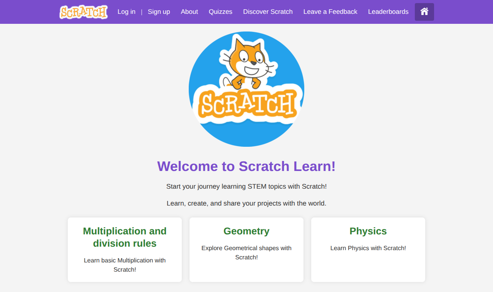
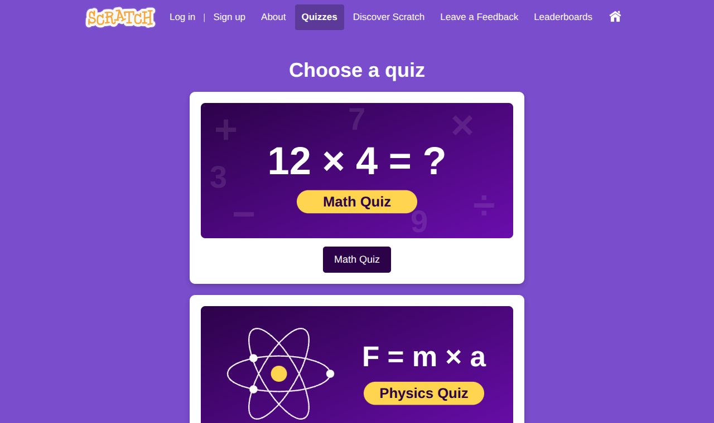
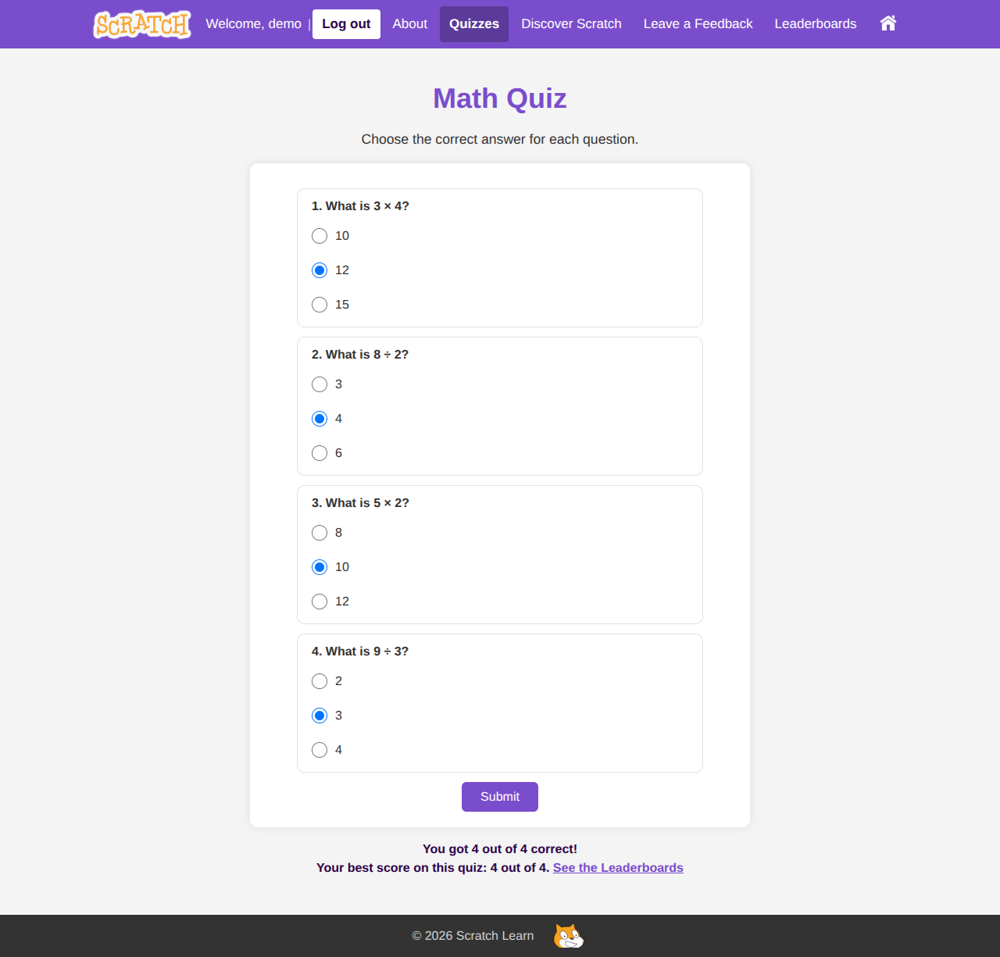
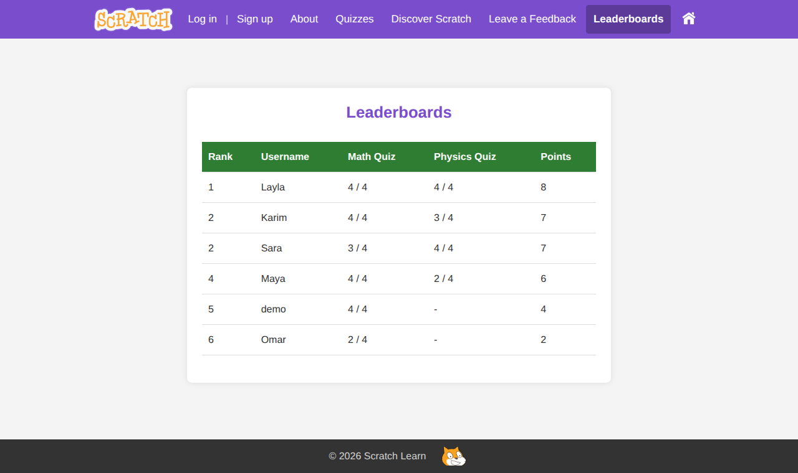
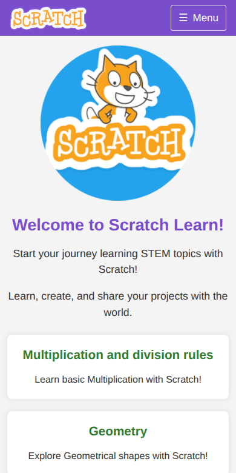
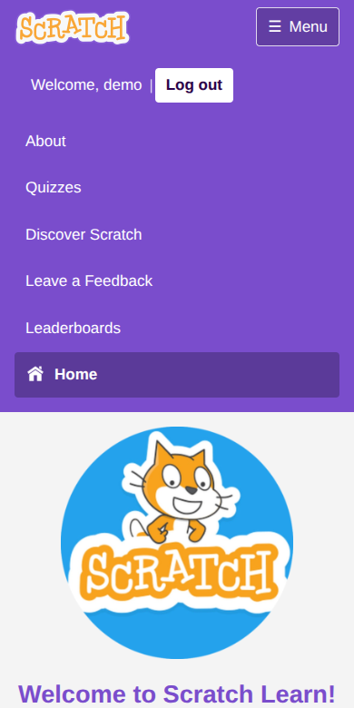

# Scratch Learn

Copy link to site: https://scratchlearn.rf.gd/SL_HomePage.html

Scratch Learn is a small educational website that teaches basic STEM topics (multiplication & division, geometry and physics) through short videos made with [Scratch](https://scratch.mit.edu/). Visitors can create an account, take quizzes, read the FAQ, leave feedback and see the list of registered learners.

It was built as a university project at the Lebanese American University (LAU) with **HTML, CSS, JavaScript/jQuery (AJAX), PHP and MySQL**.

## Live demo

> **https://scratchlearn.rf.gd/SL_HomePage.html**
> *(hosted on the free InfinityFree plan, so the first load can take a few seconds, mostly for the youtube videos embeded)*

You can create your own account on the Sign Up page, or use the demo account:

| Email              | Password    |
|--------------------|-------------|
| `demo@example.com` | `Demo1234!` |

> Please open the site through the link above. Double-clicking an `.html` file only shows the static content: PHP and MySQL need a web server, so login, sign up, feedback and the leaderboard cannot work that way.

## Screenshots

| Home | Quizzes |
|------|---------|
|  |  |

| Quiz result (logged in) | Leaderboard |
|-------------------------|-------------|
|  |  |

| On a phone | The phone menu |
|------------|----------------|
|  |  |

*The players and comments shown are made-up sample data.*

## Features

- **Lessons:** multiplication & division, geometry and physics pages, each with an explanation and a Scratch-made video.
- **Quizzes:** a Math quiz and a Physics quiz. The questions are stored in the database and loaded with AJAX; the answers are checked **on the server**, so the correct answers never appear in the page's source.
- **User accounts:** sign up, log in and log out through AJAX (no page reload on errors). Passwords are hashed with `password_hash()`; the header on every page greets the logged-in user and shows a red *Log out* link. Every form tells the visitor when something goes wrong instead of failing silently. See [Security](#security) for how accounts are protected.
- **Feedback page:** comments are validated, saved in the database and displayed right away. Includes a FAQ accordion.
- **Leaderboards:** logged-in users get their best score of each quiz saved. The leaderboard ranks players by total points (ties share a rank) and shows usernames and scores only, never emails.
- **Discover Scratch:** embedded YouTube tutorials for learning Scratch (These might take a few seconds to load).
- **About page:** presentation of the platform and its developers.
- **Responsive:** the layout adapts from small phones (320 px) to large desktop screens, and on phones the menu collapses into a *Menu* button.
- **Accessible:** keyboard friendly, readable colour contrast, labelled forms and a skip link (details in [Responsive design and accessibility](#responsive-design-and-accessibility)).

## Tech stack

| Layer      | Technology |
|------------|------------|
| Front end  | HTML5, CSS3 (one responsive stylesheet), JavaScript, jQuery 3.6 (AJAX, bundled in `js/vendor/`, no CDN needed) |
| Back end   | PHP 8 (PDO and MySQLi, sessions, prepared statements) |
| Database   | MySQL / MariaDB |
| Local dev  | XAMPP (Apache + MySQL) |
| Hosting    | InfinityFree (free PHP + MySQL hosting) |

## Security

| Protection | How it works |
|------------|--------------|
| Passwords | Hashed with `password_hash()` (bcrypt), never trimmed or logged, 8 to 72 characters, and re-hashed automatically at login when PHP's recommended strength increases |
| SQL injection | Every query uses prepared statements (PDO and MySQLi) |
| CSRF (forged requests) | Every request that changes data (login, sign-up, feedback, quiz scores) must carry a secret token that only this site's pages can obtain (`csrf_token.php`, `js/csrf.js`) |
| Brute-force protection | Failed logins are limited per account (5 in 15 minutes) and, more generously, per visitor address. Sign-ups and comments are rate-limited too. The `rate_limits` table stores only hashed keys, never IP addresses or emails. The public demo account is exempt because its password is public |
| Account enumeration | Wrong password and unknown email give the same message, and the password is checked in both cases so the answer takes the same time |
| Sessions | New session id at login (no session fixation), cookie is `HttpOnly` and `SameSite=Lax` (and `Secure` over HTTPS), strict mode on, and everything is destroyed at logout |
| XSS (injected code) | Data from the database is always shown as text, never as HTML; usernames may only contain letters, numbers, spaces, dots, dashes and underscores |
| Quiz integrity | Answers are marked on the server and never sent to the browser |
| Privacy | The leaderboard shows usernames and scores only (no emails); error details go to the server log, never to visitors |
| Secrets | Database credentials live in one git-ignored `config.php` |
| Spam | Hidden trap field on the feedback form plus rate limiting |

Known limitations, kept simple on purpose: logging out is a normal link, sign-up tells you when an email or username is already taken, and there is no email verification or password reset yet. Redirecting to HTTPS and adding extra security headers can be done with an `.htaccess` file on hosts that allow it.

## Project structure

```
README.md
.gitignore
docs/screenshots/              <- the pictures used in this README
ScratchLearn/                  <- the website (this folder is what goes in htdocs)
├── index.html                 redirects to SL_HomePage.html
├── SL_HomePage.html           home page
├── About_SL.html              about page
├── Quizes.html                quiz menu
├── MathQuiz.html / physQuiz.html    quiz pages (questions are loaded by js/quiz.js)
├── Muldiv.html / geometry.html / physics.html    lessons
├── learnonyourown.html        Discover Scratch (YouTube tutorials)
├── feed.html                  feedback + FAQ
├── Leaderboards.html          players ranked by points
├── LogIn_SL.html / SignUp_SL.html
├── config.sample.php          database settings template (copy to config.php)
├── config.php                 YOUR database settings (git-ignored, not in the repo)
├── db.php                     PDO connection used by login/register/feedback
├── security.php               shared helpers: secure sessions, CSRF, rate limiting
├── csrf_token.php             gives the pages their CSRF token
├── session_info.php           returns the "Welcome / Log in" header content
├── login.php, logout.php, register.php
├── submit_feedback.php, load_feedback.php
├── fetch_leaderboard.php      JSON leaderboard (usernames, scores, points)
├── get_quiz.php               JSON questions of one quiz (no answers revealed)
├── check_quiz.php             marks the answers and saves the user's best score
├── favicon.ico                small site icon (more icon files are in imgs/)
├── css/css.css                the one stylesheet of the whole site
├── js/csrf.js                 ScratchLearn.post(): adds the CSRF token to every POST
├── js/quiz.js                 builds a quiz from get_quiz.php and sends the answers
├── js/layout.js               builds the shared header (menu) and footer
├── js/session.js              fills the login/logout area of the header
├── js/vendor/jquery-3.6.0.min.js    jQuery, bundled
├── imgs/                      images, quiz cards, favicon files
├── videos/                    lesson videos (compressed) and their poster images
└── database/
    ├── scratch_learn_db.sql                 complete database for a NEW install (tables, quizzes, demo account)
    ├── upgrade_scores_and_physics_fix.sql   only for upgrading an OLDER database (see below)
    └── upgrade_step4_rate_limits.sql        only for upgrading an OLDER database (see below)
```

## Database

The database is called `scratch_learn_db` and has seven tables:

| Table       | Purpose |
|-------------|---------|
| `users`     | `id`, `email` (unique), `username` (unique), `password` (bcrypt hash) |
| `quizzes`   | one row per quiz (Math Quiz, Physics Quiz) |
| `questions` | quiz questions, linked to `quizzes` by `quiz_id` (foreign key) |
| `answers`   | answer options, linked to `questions` by `question_id` (foreign key), `is_correct` marks the right one |
| `feedback`  | name, message and timestamp of each comment |
| `rate_limits` | recent login / sign-up / feedback attempts under a hashed key (brute-force and spam protection) |
| `scores`    | best `score` (out of `total`) of each user for each quiz, linked to `users` and `quizzes` (one row per user and quiz) |

## Authors

Hani Srour and Ali Ghandour, students at the Lebanese American University.
